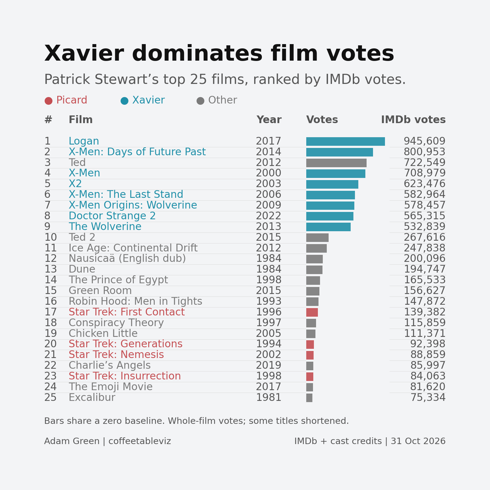
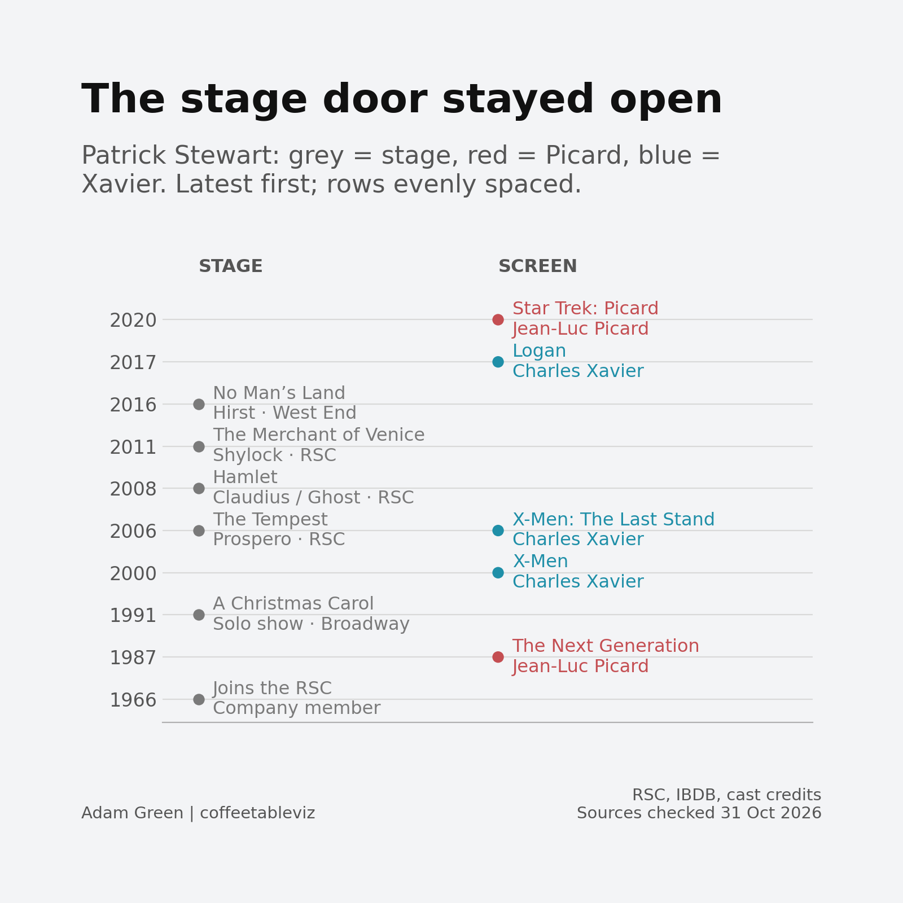
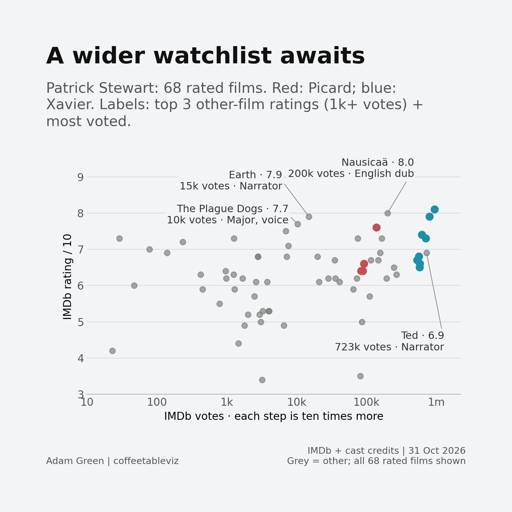

# Patrick Stewart: beyond Picard and Professor X

*A three-chart tribute to Sir Patrick Stewart, 1940–2026.*

A starship captain. A school for mutants. A voice that could make a fairly improbable situation sound entirely reasonable.

Picard and Professor Xavier are familiar ways into Patrick Stewart’s career. But a look through the work soon produces a much longer watchlist.

## Xavier takes most of the film votes

Across this set of **70 documented films**, the eight in which Stewart plays Xavier account for **61% of available IMDb votes**. The four Picard films account for **4.6%**.

Logan leads the ranking, followed by X-Men: Days of Future Past. But third place belongs to Ted, with Stewart narrating rather than appearing on screen.

A talking teddy bear gets between two X-Men films. There’s a little more range here than the headline suggests.

The Star Trek films sit further down. First Contact ranks 17th, Generations 20th, Nemesis 21st and Insurrection 23rd. The chart shows the full top 25, so these are their positions in the same continuous ranking.

That tells us about voting activity around these films. Picard’s television work is outside the comparison, so this cannot settle which character mattered most to audiences. And a vote for a film is hardly a vote for one particular actor.

## The stage door stayed open

Stewart joined the [Royal Shakespeare Company](https://www.rsc.org.uk/news/in-tribute-to-rsc-honorary-associate-artist-sir-patrick-stewart) in **1966**, 21 years before Picard’s television debut.

The tempting version of that story is a move from Shakespeare to Hollywood. But for Stewart his love and talents bridges both with equal mastery.

In **2006**, he was both Prospero in The Tempest and Xavier in X-Men: The Last Stand. He played Claudius and the Ghost in Hamlet in 2008, then Shylock in The Merchant of Venice in 2011.

By 2016, he was playing Hirst alongside Ian McKellen in No Man’s Land in the West End.

Theatre kept finding its way back into the diary. It was far more than an early chapter before the spaceships arrived.

## You don’t always need to see him

The wider film chart offers a few places to explore next.

Among films outside the Picard and Xavier roles, **Nausicaä of the Valley of the Wind scores 8.0**, Earth **7.9**, and The Plague Dogs **7.7** in the 31 October snapshot. Those are the three highest ratings in this set among other films with at least 1,000 votes.

Ted gets a label for a different reason: with roughly **723,000 votes**, it is the most-voted film outside those two roles.

The nice connection is that **all four involve Stewart’s voice**: an English dub, documentary narration, an animated character and comic narration.

Even a watchlist prompted by a familiar face can end up somewhere you never see it.

These are ratings for the films, of course, rather than marks for Stewart’s performances. For Nausicaä, they also cover the whole film, not just the English dub in which he appears.

Picard and Xavier are good places to start remembering Patrick Stewart. There is plenty in the rest of the work to keep us watching—and listening.

---

### A note on the numbers

The film charts use **70 documented IMDb movie titles released through 2025**, combining [IMDb’s official datasets](https://data.imdb.com/non-commercial-datasets/) with documented credits from [Independent Talent](https://www.independenttalent.com/actors/patrick-stewart/), film catalogues and cast listings. This is a documented selection, not a complete filmography. Television, shorts and games are excluded; voice roles, later dubs and cameos are included.

Two films have no recorded votes or ratings, leaving **68** in the scatter chart. All 68 are plotted; the 1,000-vote rule selects labels only. IMDb votes are not unique viewers, and ratings can change. The vote axis on the scatter uses tenfold steps.

Chart 1 shows the top 25 by votes, using exact counts and bars on a shared zero-based linear scale.

The stage chart shows selected milestones, latest first, with evenly spaced rows rather than a continuous time scale. Theatre dates and roles were checked against the RSC, [IBDB](https://www.ibdb.com/broadway-production/a-christmas-carol-4655) and [Official London Theatre](https://officiallondontheatre.com/show/no-mans-land-356944/). Film years refer to original release, including where Stewart contributed to a later dub. Ratings and votes were retrieved on **31 October 2026**.
