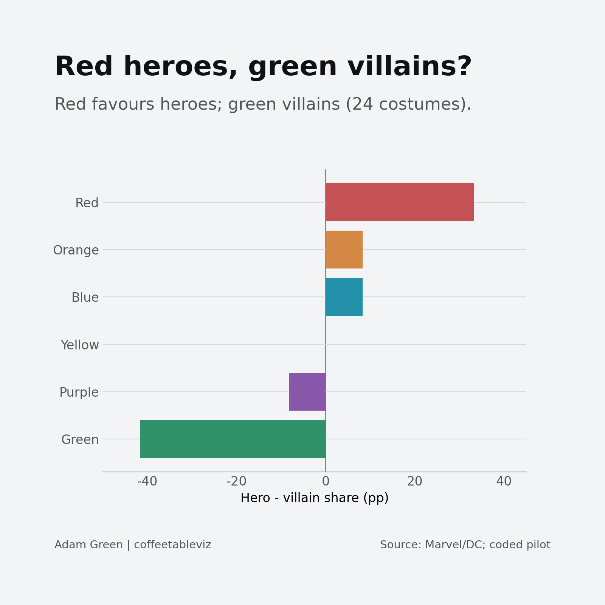
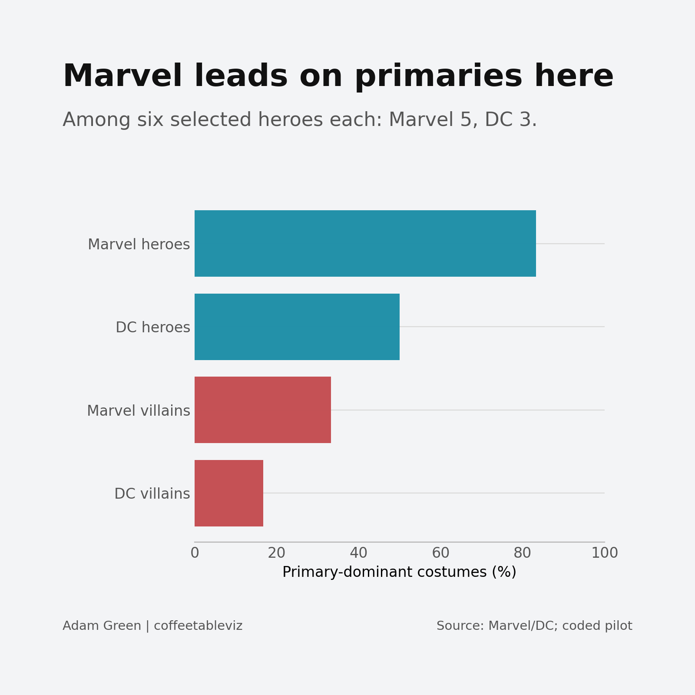
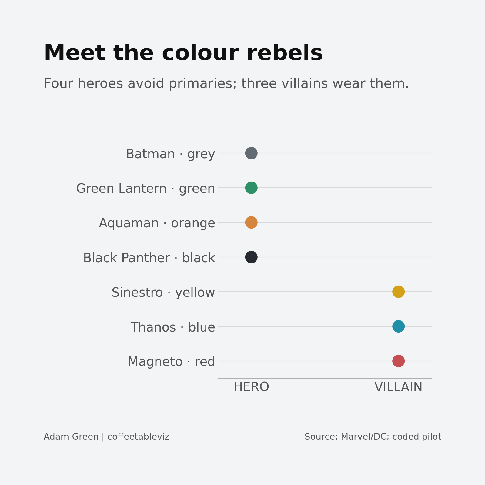

# What colour is a villain?

*Working draft · Culture · not for publication until costume coding is validated*

Look at a comic-book costume and it can feel as though the colour palette tells you who's here to save the day — and who is about to make things considerably worse.

Red, blue and yellow for the heroes. Green and purple for the troublemakers.

That was the idea I first played with in my [Shades of Heroism Tableau visualisation](https://public.tableau.com/app/profile/adam.green4310/viz/Shadesofheroism/shadesofheroism), inspired by Tim Leong's *Super Graphic*. This time, the characters are back in **comic-book costumes**, not film adaptations, and the data has a paper trail.

## Red to the rescue?

Among the **12 heroes and 12 villains** selected for this small study, red is the most frequent dominant hero costume colour: **five heroes against one villain**. Green almost reverses the balance: **six villains against one hero**.

It looks like a code.

Except orange appears on the **hero** side. Aquaman, in his classic orange-and-green outfit, clearly didn't get the memo.

And none of these bars represents the percentage of fabric in a colour. They represent the **share of characters whose most prominent costume hue was coded that way**.

## Marvel and DC don't quite match

Traditional primary colours — **red, yellow and blue** — dominate the selected costumes of **five of six Marvel heroes**, compared with **three of six DC heroes**.

That sounds like a publisher rivalry. It isn't, at least not yet. These are just six familiar heroes chosen from each publisher, not a representative sample of the thousands who have appeared in the comics.

Still, the contrast is a useful question for a bigger dataset.

## The rebels are the interesting part

Batman and Black Panther make a convincing case for black and grey. Green Lantern gets the heroic job done in green. Aquaman prefers orange. On the other side, Sinestro's yellow, Thanos' blue and Magneto's red all challenge the simple rule in the **specific costume versions coded here**.

Some of those villains have complicated histories. The costume versions matter too: change the story arc or the illustrator and the answer might change.

The rule is a visual convention, not a moral compass.

## A necessary costume disclaimer

This is a **curated 24-character pilot**, with six heroes and six villains from each publisher. One recognisable comic-book costume was chosen per character. Skin and hair are excluded. Neutral hues are retained rather than squeezed into primary or secondary groups. Gold is kept distinct from yellow.

The dominant hues are **editorial observations**, not pixel measurements. Publisher sources support many of the colour combinations, but exact issue-level artwork and the most prominent hue still need independent confirmation before any publication claim. Five alternative costume codings were stress-tested; the direction of the hero–villain difference survives *those five changes in this pilot*, but the sample itself can still be biased.

## TLDR

In this deliberately small line-up, heroes wear more red and villains more green. But the outliers are the better story. A comic-book colour code is a useful shortcut — just don't mistake it for a rule.

*simple charts, clear stories*

### Sources and further reading
- [Original Coffeetableviz article](https://coffeetableviz.com/2025/01/17/shades-of-heroism/)
- [Tim Leong, *Super Graphic* (Wired excerpt)](https://www.wired.com/2013/07/excerpt-visual-guide-to-the-comic-book-universe/)
- [Marvel's history of Wolverine's costume variations](https://www.marvel.com/articles/comics/wolverine-logan-james-howlett-every-costume-list)
- [DC's look at Aquaman's changing costumes](https://www.dc.com/blog/2023/12/14/from-the-runways-of-atlantis-six-forgotten-aquaman-costumes)
- Complete row-level source and coding notes: `../data/source_evidence_audit.csv`, `../METHODOLOGY.md`
