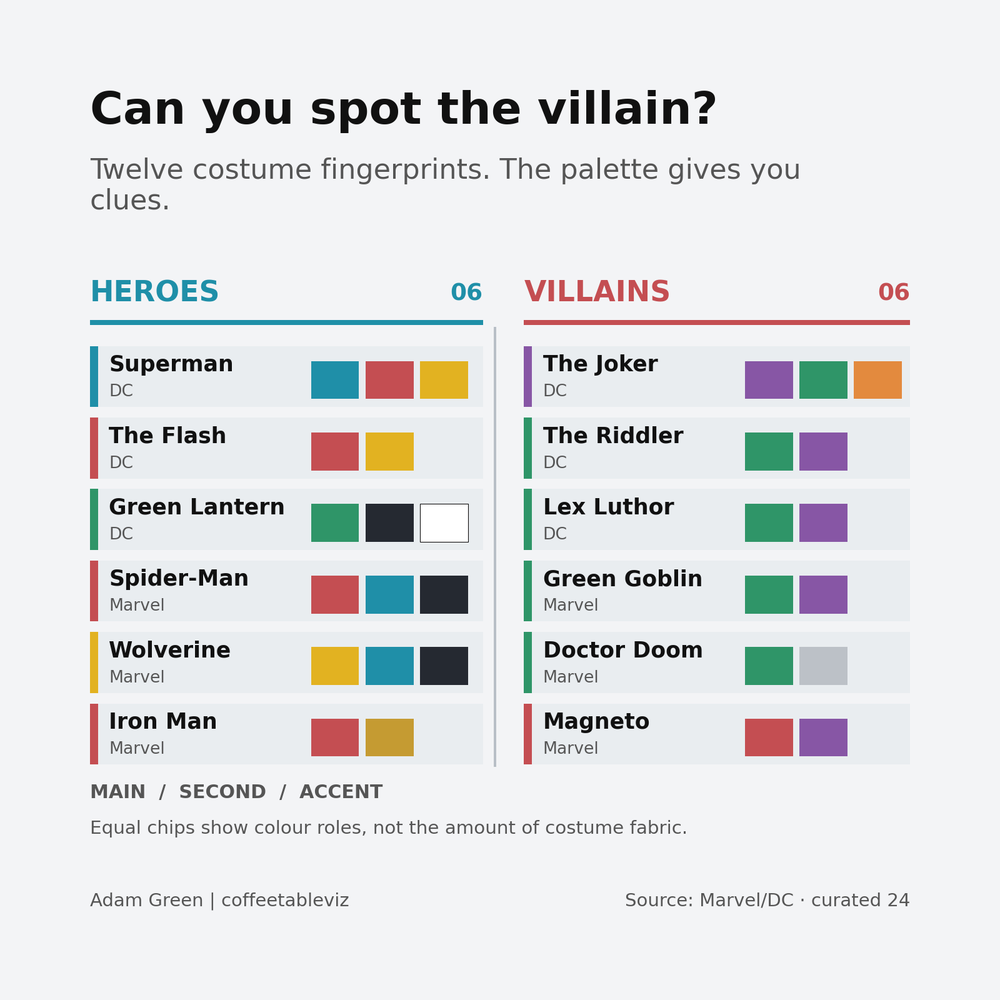
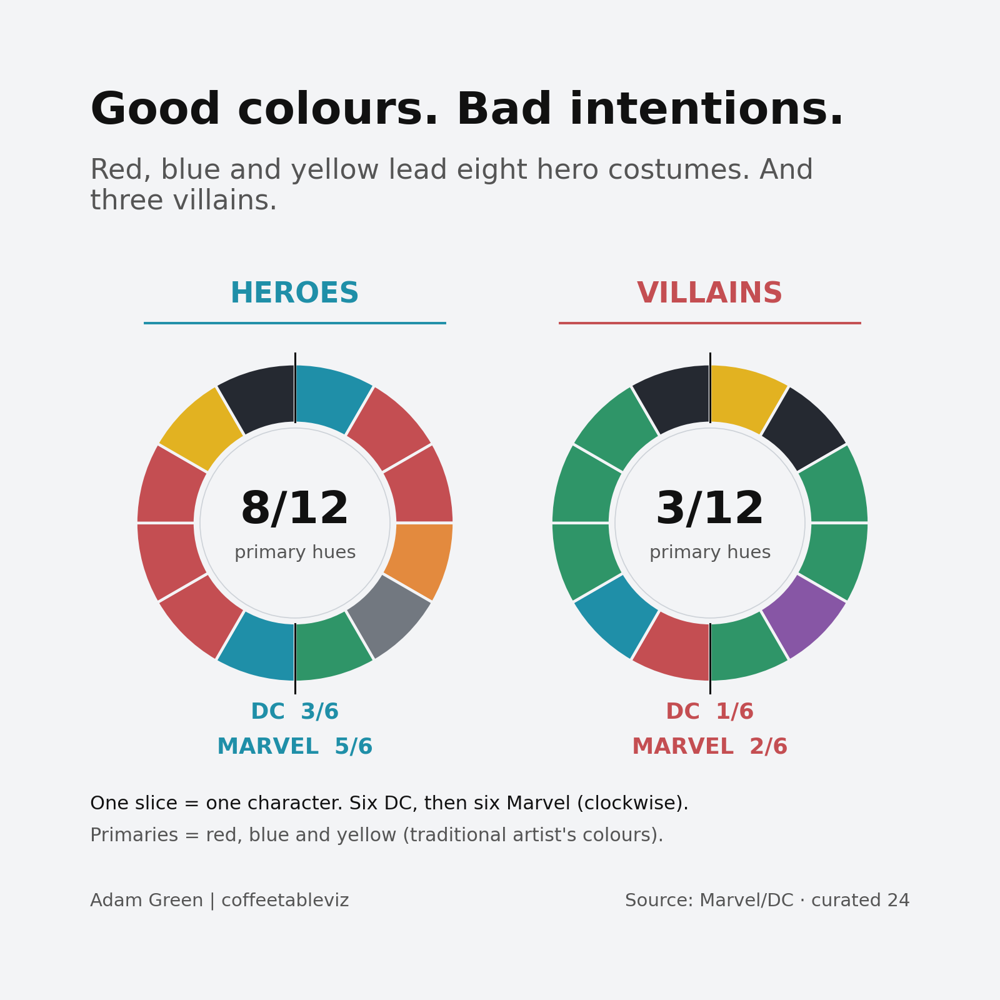
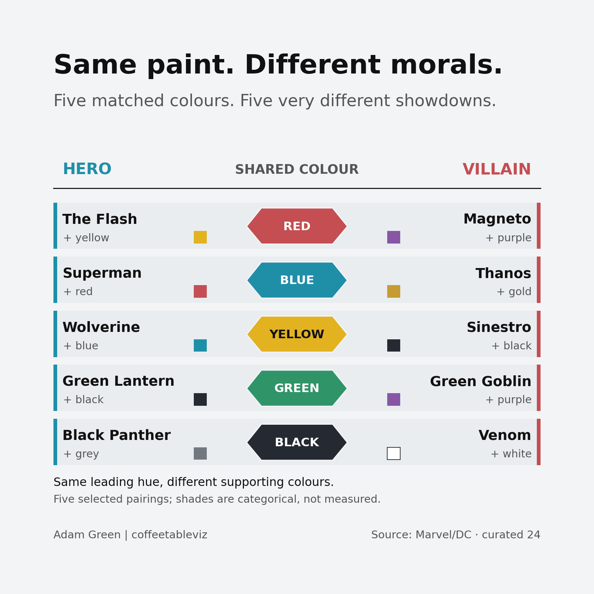

# Who wears the hero colours?

*Working Coffeetableviz draft — Culture. Not publication approved.*

You probably know the comic-book dress code, even if nobody gave you a copy.

Superman gets blue and red. The Joker gets purple and green. Green Goblin looks as though he got dressed in an abandoned chemistry lab.

The old shorthand is simple: **red, yellow and blue for the heroes; green, purple and orange for the villains**. It's the colourful idea behind Tim Leong's *Super Graphic*, and an idea I first played with in my 2025 [Shades of Heroism Tableau viz](https://coffeetableviz.com/2025/01/17/shades-of-heroism/).

This time the challenge was to look past the colours in isolation. **Does the whole costume give away which side someone is on?**

## A case of wardrobe identity

Here are 12 recognisable costumes from Marvel and DC, recreated as colour fingerprints. The chips are ordered **main → supporting → accent**, rather than pretending we've measured exactly how many square inches of spandex are red.

On the heroes' side, the Flash is red and yellow. Superman is blue, red and yellow. The villains seem to have raided the green and purple aisles.

But look closer. Green Lantern is green. Magneto is red. The neat divide is already showing cracks.

## Three villains missed the dress-code memo

Across the **24 costume versions selected for this study**, eight of 12 heroes have a red, yellow or blue *main* colour.

So do **three of 12 villains**.

Each wheel has **12 equal slices**, one for each selected character. The first six in each wheel are DC characters, followed by six Marvel characters clockwise. DC's six chosen heroes split three primaries to three other hues, while five of Marvel's six selected heroes use primaries. That's a feature of **this deliberately picked group**, not proof that one publisher has a stronger moral colour code.

Each slice is a character, **not a percentage of costume fabric**.

### Who's behind the colour wheels?

Here's the cast behind the slices. The entries are in the same order as the wheels, with the first six DC and next six Marvel on each side. Rows are a compact reference list, **not hero–villain match-ups**. Colours in **bold** are traditional red, yellow and blue primaries.

| Role | DC character · main hue | Marvel character · main hue |
|:--|:--|:--|
| Hero | Superman · **blue** | Captain America · **blue** |
| Hero | The Flash · **red** | Daredevil · **red** |
| Hero | Wonder Woman · **red** | Iron Man · **red** |
| Hero | Aquaman · orange | Spider-Man · **red** |
| Hero | Batman · grey | Wolverine · **yellow** |
| Hero | Green Lantern · green | Black Panther · black |
| Villain | Sinestro · **yellow** | Magneto · **red** |
| Villain | Black Manta · black | Thanos · **blue** |
| Villain | Lex Luthor · green | Doctor Doom · green |
| Villain | Poison Ivy · green | Green Goblin · green |
| Villain | The Joker · purple | Loki · green |
| Villain | The Riddler · green | Venom · black |

*Character roles and costume hues are provisional, pending issue-specific artwork verification.*

## A colourful identity crisis

Now the fun bit.

The Flash and Magneto both wear red. Superman and Thanos share blue. Wolverine and Sinestro share yellow.

And there's a green-versus-green confrontation waiting between Green Lantern and Green Goblin.

Even the black suits tell two stories: Black Panther on one side and Venom, in his classic adversary guise, on the other.

**Five pairs, five matching leading colours, ten very different characters.**

The supporting colours change the look, while the characters' histories change what we read into it. If you judged a comic-book universe only by the first colour you saw, you'd be wrong rather quickly.

## How the data was assembled

This is an **illustrative set of 24 characters**, balanced as six heroes and six villains from DC and from Marvel. Each character has one specified comic-book costume or era; character identity and costume coding aren't assumed to stay fixed forever. The colours are editorial classifications from publisher references, not percentages of fabric captured from images.

That matters. A costume may change by issue, writer or artist, and some characters have switched sides. The full issue-specific art review is still outstanding, so the colour coding remains provisional.

## TLDR

The comic-book colour code exists as a design tradition, and you can spot echoes of it here. But a hero can wear green, a villain can wear blue, and nobody owns red.

Maybe the best thing a costume does isn't tell you who's good.

**It's give you someone to recognise.**

*simple charts, clear stories*

### Sources
- [Tim Leong's *Super Graphic* excerpts in Wired](https://www.wired.com/gallery/excerpt-visual-guide-to-the-comic-book-universe/)
- [ACMI's history of colour coding in superhero costumes](https://www.acmi.net.au/stories-and-ideas/primary-colours-adapting-superhero-costumes-from-page-to-screen/)
- [DC costume profile and variation sources](https://www.dc.com/characters)
- [Marvel comic character profiles](https://www.marvel.com/characters)
- Row-by-row reference log and exceptions: `../data/source_evidence_audit.csv` and `../METHODOLOGY.md`.
